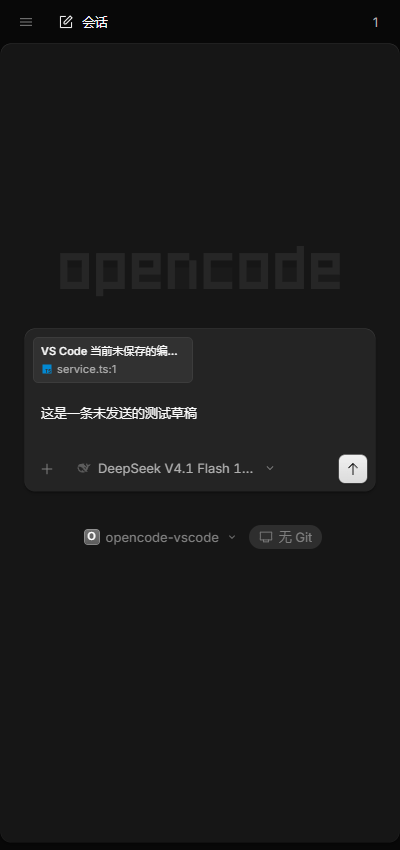

# OpenCode Sidebar

将官方 OpenCode Solid UI 显示在 VS Code 侧栏，连接本机共享服务。聊天、历史会话、模型选择、工具过程、权限和提问界面均复用 OpenCode 的组件与逻辑。

这是 HunkYuan 维护的第三方扩展，使用 MIT 许可的官方 UI。



## 安装

要求：VS Code 1.94+、本机已安装 [OpenCode CLI](https://opencode.ai)。首次安装附带已验证的官方 UI，后续 UI 包按已验证的 service 兼容范围独立更新。

1. 从 [GitHub Releases](https://github.com/HunkYuan/opencode-vscode/releases/latest) 下载对应版本的 `.vsix`。
2. 在 VS Code 扩展菜单选择 **Install from VSIX…** 安装。
3. 打开本地项目，执行 **OpenCode: Open Sidebar**，或按 `Ctrl+Alt+O`（macOS：`Cmd+Alt+O`）。
4. 选中代码，右键 **OpenCode: Add Selection** 或按 `Ctrl+Alt+K`，确认附件后输入需求。
5. 使用侧栏标题上的 diff 按钮，在 VS Code 原生 diff 中审阅本轮改动。

## 功能与命令

| 命令 | 用途 |
|---|---|
| OpenCode: Open Sidebar | 打开官方 UI 侧栏 |
| OpenCode: New Session | 在当前工作区新建会话 |
| OpenCode: Add Current File | 添加当前编辑器的文本快照，包含完整文件路径 |
| OpenCode: Add Selection | 添加精确选区和范围，支持未保存内容 |
| OpenCode: Review Changes | 在原生 diff 中查看本轮改动 |
| OpenCode: Reconnect | 重新发现并连接 service |
| OpenCode: Enable Shared Service | 用户主动启用被禁用的 service |
| OpenCode: Show Logs | 查看插件日志 |
| OpenCode: Check UI Updates | 主动检查并下载兼容 UI 包 |
| OpenCode: Apply UI Update | 保存草稿后应用已下载的 UI 包 |
| OpenCode: Roll Back UI | 回退并固定上一份兼容 UI 包 |

文件和选区在添加时捕获编辑器文本，通过官方 Blob 附件发送 UTF-8 快照。VS Code 正确解码的 GBK 等源码可正常发送，磁盘文件保持原编码；添加后继续编辑时，再执行一次添加命令更新快照。

工具按 OpenCode 的权限规则执行并直接修改磁盘，diff 用于修改后的审阅。首版没有单文件撤回按钮。

## 共享服务与设置

首次打开侧栏会发现并复用本机共享 service。未运行时按需启动，关闭 VS Code 后 service 继续运行；多个 VS Code 窗口和 TUI 可以共用。

| 设置 | 默认 | 说明 |
|---|---|---|
| `opencodeSidebar.cliPath` | 空 | 从 PATH、标准 npm 或 `.opencode/bin` 定位 CLI；Windows 推荐指定 `opencode.exe` |
| `opencodeSidebar.autoStart` | true | 缺少 service 时自动启动，OpenCode 的 disabled 设置优先 |
| `opencodeSidebar.followTheme` | true | 跟随 VS Code 深浅主题 |
| `opencodeSidebar.uiAutoUpdate` | true | 自动下载兼容 UI；下次启动或重建侧栏时使用 |

- `opencode service get disabled` 为 true 时，展示原因和启用按钮。
- UI 与 service 版本不同会提示并复用。接口不兼容时提示更新，不因 UI 版本替换 service。
- 凭据保留在 Extension Host，回环转发支持 HTTP、SSE、WebSocket 和请求取消。
- 会话历史保留在 service，侧栏 tab、草稿和附件保存在 VS Code 工作区存储。

## 独立 UI 更新

打开侧栏时自动检查 [UI 更新清单](https://raw.githubusercontent.com/HunkYuan/opencode-vscode/ui-updates/stable.json)，每 6 小时刷新。UI ZIP 包含官方界面、Client SDK 和宿主适配；按 service 兼容范围及宿主协议选包，下载校验后存入 VS Code 插件全局存储。当前聊天继续使用原包，正常启动或重载后自动切换。

无需每次重装 VSIX。Apply UI Update 可主动提前切换，先保存草稿；OpenCode 正在工作时不切换。Roll Back UI 会固定旧包，主动执行 Check UI Updates 可恢复自动选择。下载失败保留当前包，UI 启动失败回退。服务版本尚未验证时保留已有 UI 并记录原因，不更换运行中的 service。

仓库自动监测官方 GitHub 和 npm 正式版，发现更高版本后准备候选更新；固定源码在 Windows/Linux 通过构建、附件、草稿、更新回退、权限和表单测试后，自动合并、发布 UI 包并更新清单。失败候选停止发布，等待修复。OpenCode CLI 本身仍按原有方式升级。

UI 使用 `ui-*` Release 标签并保持 VSIX 的 latest Release。完整协议、缓存和流水线见 [独立 UI 包设计](docs/UI-PACKAGES.md)。

## 从源码构建

要求：Git、Bun 1.4.2、`tar`。Windows 10/11 自带 `tar.exe`。

`setup` 默认下载 [upstream.json](upstream.json) 指定 commit 的官方源码，下载、依赖和构建产物都在插件目录内。

```sh
git clone https://github.com/HunkYuan/opencode-vscode.git
cd opencode-vscode
bun run setup
bun install --frozen-lockfile
bun run check
bun test ./test
bun run package
```

生成的 `.vsix` 在仓库根目录，独立 UI ZIP 与声明位于 `artifacts/ui/`。`bun run build:host` 单独构建扩展壳，`bun run build:ui` 单独构建并打包 UI。安装后无需 Bun、官方源码目录或本项目的 `.upstream` 快照。

若已在本机准备对应 commit 的 OpenCode 源码，可以传入只读来源目录：

```sh
bun run setup ../opencode
```

准备完成后在 VS Code 打开插件目录，按 F5 启动独立 Extension Development Host。

| 目录 | 内容 |
|---|---|
| `src/` | 侧栏、service、网络、编辑器与存储适配 |
| `webview/` | 官方 UI 启动、主题、路由及消息桥 |
| `scripts/` | 构建、来源准备、许可与可选联调 |
| `test/` | 网络、草稿和 diff 契约测试 |
| `resources/fonts/` | UI 实际使用的 IBM Plex 字体和许可 |
| `.upstream/` | 固定来源的构建快照，Git 忽略 |
| `dist/` | Host 与 Webview 产物，Git 忽略 |

构建层适配 Webview 的 Worker 和 SVG sprite 限制，保留官方业务源码。Bun 锁文件和来源 commit 一同提交。CI 从干净环境执行 setup、锁定安装、检查、测试和 VSIX 构建。

## 验证与使用范围

Windows 上已验证：

- 真实 VS Code 1.94 扩展激活、侧栏、文件附件及 VSIX 安装。
- 真 service 的窄宽布局、模型和工作区显示、选区与草稿恢复。
- 隔离 service 的 disabled、自动启动关闭、按需启动及并发复用。
- 官方消息、Markdown Worker、工具、权限按钮回复及提问表单。
- HTTP/SSE/WebSocket、草稿引用与写入顺序、完整 patch、CRLF 和无末尾换行。

Linux、macOS 的实际编辑器使用尚未手动验证。首版面向本机工作区，Remote SSH、WSL 远端工作区暂不支持。

建议在自己的项目中自测：发送真实需求、确认／拒绝权限、停止执行、检查改码 diff，再重载窗口验证草稿和附件。

可选联调：

```sh
bun run test:service
bun run test:ui
bun run test:attachments
bun run test:ui-update
bun run test:vscode /path/to/Code.exe
```

`test:attachments` 使用独立 service 和本地模型接口，核对请求、服务端附件以及模型收到的文本；覆盖 GBK、UTF-8、未保存内容、选区、空文件和草稿重载。`test:ui-update` 验证下载、草稿、原生 diff 查询与回退；`test:vscode` 额外验证真实编辑器的 GBK、未保存选区、文件跳转、原生 diff 以及更新和回退后继续发送，需要指定 VS Code 可执行文件。

`test:ui` 和 `test:attachments` 在 Windows 默认使用 Edge，其他平台需先安装 Playwright Chromium。可以通过 `OPENCODE_TEST_BROWSER` 指定浏览器可执行文件。真 service 测试复用已有服务，fixture 测试使用隔离配置和独立端口。

## 许可与记录

[MIT License](LICENSE) · [第三方许可](THIRD_PARTY_NOTICES.md) · [变更记录](CHANGELOG.md) · [工作日志](docs/WORKLOG.md) · [验证记录](docs/VALIDATION.md)

OpenCode 官方源码：[anomalyco/opencode](https://github.com/anomalyco/opencode)，固定来源见 [upstream.json](upstream.json)。
