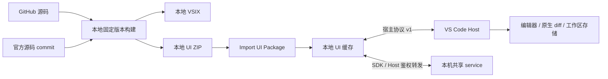

# SOURCE-001 — 源码分发与本地 UI 包

结论：GitHub 提供源码和文档，使用者在本机构建 VSIX 或 UI ZIP。插件从本地导入 ZIP，保留 Host/UI 边界、共享 service、草稿保存和回退。

状态：本地导入实现与开发运行验证完成，正在打包验证。日常项目验收待用户完成。

## 分发与费用状态

| 项目 | 状态 |
|---|---|
| 仓库 Actions | enabled=false；源码中的四个 workflow 已移除 |
| 定时监测、PR 自动合并和自动发布 | 已移除 |
| Release 附件 | 原十二个附件已删除；不再上传新附件 |
| Actions 产物与缓存 | 原二十八份产物、两项缓存已删除 |
| 在线 UI 清单 | 已清空，插件不再读取 |
| 源码、标签、历史 Release 文字 | 保留 |
| 本机旧安装包、数据和用户 service | 保留 |

用户确认账号 Actions `$0` 硬预算及停止选项已设置；该确认不等同于个人 API 回读。删除存储不撤销已累计的历史计量。当前更新流程无需 GitHub token。

## 结构



Host 不运行 OpenCode SDK；UI 包同时包含官方组件、Client SDK、宿主适配和资源。版本变化集中到本地包构建，协议不兼容时拒绝导入。workspaces 的 tab、草稿和附件键不随包版本改变。

## 构建流程

首次安装：

```sh
git clone https://github.com/HunkYuan/opencode-vscode.git
cd opencode-vscode
bun run setup
bun install --frozen-lockfile
bun run check
bun test ./test
bun run package
```

VSIX 位于仓库根目录。安装后自带该次构建的 UI，运行时不需要构建工具。

准备更新：

```sh
bun run ui:upstream 2.1.4
bun run check
bun test ./test
bun run build:ui
```

可传入只读的本地 Git 源码：

```sh
bun run ui:upstream 2.1.4 ../opencode
```

默认读取官方不可变 tag，固定 commit；本地来源从 HEAD 和 package.json 确认 commit／版本。命令只更新插件工作目录的来源声明、依赖与锁文件，不创建 Git 提交、分支、PR 或远端推送。同一版本再次准备增加修订号，不同版本从修订 1 开始。上游接口或组件结构变化仍可能需要维护适配。

## ZIP 与完整性

`artifacts/ui/` 输出 UI ZIP、`ui-package.json` 和 `SHA256SUMS.txt`，包含：

| 内容 | 用途 |
|---|---|
| `ui-manifest.json` | 包 ID、修订、官方版本／commit、宿主协议、service 范围和入口 |
| `ui-integrity.json` | 包内每个文件的 SHA256，与实际文件集合逐项核对 |
| 官方 UI／SDK／资源 | 同次编译，保持版本配套 |
| LICENSE／第三方许可 | 本地分发所需许可 |
| 外部 `ui-package.json` | ZIP 文件名、SHA256、大小及插件源码 commit |

ZIP 不包含在线 Release 地址。导入仅接受本地文件；完整性清单检查损坏与缺失文件，来源信任由选择包的使用者负责。旧 0.2.0 ZIP 不含该清单，需重新构建。

只执行 `build:ui` 会复用当前包 ID；修改内容时先执行 `ui:upstream` 增加修订。相同 ID 的不同内容、内置同 ID、协议不匹配、service 不兼容、异常路径和缺失资源均被拒绝。

## 导入、应用与回退

1. 执行 **OpenCode: Import UI Package**，选择本地 ZIP。
2. 先校验全部文件、协议与当前 service 范围，再放入 `globalStorageUri/ui/packages/<包 ID>`。
3. 导入只更新待应用状态，已打开聊天继续运行原包。正常重载时使用新包。
4. **Apply UI Update** 主动重载时先 flush 草稿和 Blob；正在工作则延后。
5. **Roll Back UI** 使用上一份可用兼容包。再次导入新包会取消回退选择。
6. 新 UI 未完成启动握手时标记失败并回退；共享 service 保持运行。

旧 0.2.0 的缓存选包和回退字段继续读取，catalog 和 lastCheck 等在线字段不再使用。无需清空旧会话、草稿或附件。

## 已修改的位置

| 位置 | 内容 |
|---|---|
| `.github/workflows/*` | 删除四份已退役 Actions 定义 |
| `src/ui/` | 本地清单、完整性校验、缓存导入、应用选择与回退 |
| `src/sidebar.ts`、`src/extension.ts`、`package.json` | Import UI Package 入口；移除自动更新配置与 Check UI Updates |
| `scripts/ui-package.ts` | 无在线地址的 ZIP、声明和 SHA256 构建 |
| `scripts/ui-upstream.ts` | 显式本地版本准备，替代原 GitHub 自动 PR |
| `scripts/ui-publish.ts`、`scripts/github.ts` | 删除仅用于远端发布的脚本 |
| 包测试与 smoke | 本地导入、损坏包、兼容、重载草稿、发送、diff、应用和回退 |
| README、Changelog 与记录 | 当前使用流程及退役历史 |

## 验证与使用范围

- `bun run check` 与十四项单测通过。
- 固定 OpenCode 2.1.4 的本地来源准备、依赖安装与 UI ZIP 构建通过。
- 浏览器验证本地导入后重载、GBK 发送、模型收到完整内容、diff 查询、回退及草稿。
- 真实 VS Code 1.94 验证 Import UI Package、应用／回退后再次发送、GBK／未保存选区、文件定位和原生 diff。
- 测试使用隔离 XDG 与独立端口，没有停止或替换用户 service。
- GitHub 保留源码，不执行 CI 或上传构建产物。Windows 日常项目仍需用户安装自测。
