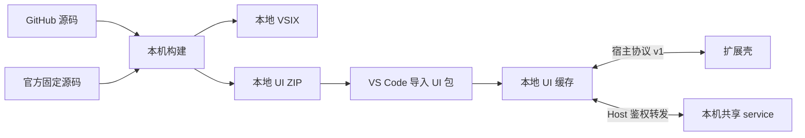

# SOURCE-001 — 源码分发与本地 UI 构建计划

状态：用户要求暂停原自动发布方案，并确认停用全部 Actions、由助手清理 Release 附件。远端清理已完成；插件本地包导入改造尚未开始。

## 已执行的范围

| 项目 | 结果 |
|---|---|
| 仓库 Actions | 仓库级 enabled=false，四个 workflow 均 disabled_manually |
| 定时上游监测与自动发布 | 已停用 |
| Release 附件 | 五个 Release 的十二个附件全部删除 |
| Actions artifacts | 二十八份已完成运行的产物全部删除，释放 1,137,744,414 bytes |
| Actions cache | 两项缓存全部删除，释放 74,665,036 bytes |
| 自动下载清单 | ui-updates 分支 stable.json 的 releases 清空 |
| 源码、标签、历史 | 保留 |
| Release 文字记录 | 保留，作为历史记录，不再提供安装包 |
| 本机文件与共享 service | 未删除本机 VSIX/UI 包，未停止或更换 service |

清理后的 Actions artifact 和 cache 库存均为零。远端清理证据位于本机 artifacts/publish/source-only-after.json。

用户已确认个人账号设置 Actions 产品 $0 预算，并启用 Stop usage when budget limit is reached。该确认来自用户回复，未通过个人账号 API 回读。删除远端存储只减少后续占用，不追溯撤销已经累计的历史计量。

## 目标

GitHub 提供源码和文档，不执行 Actions，不提供 VSIX/UI ZIP 下载，也不替用户自动合并上游更新。使用者在自己的电脑编译插件和 UI 包。

保留已有的官方组件、Host 协议、service 发现与启动、编辑器快照、原生 diff、工作区存储和本地回退机制。



## 现有源码已支持的构建流程

完整安装包目前可以本地构建：

```sh
git clone https://github.com/HunkYuan/opencode-vscode.git
cd opencode-vscode
bun run setup
bun install --frozen-lockfile
bun run check
bun test ./test
bun run package
```

VSIX 输出到仓库根目录，用户通过 Install from VSIX 安装。运行时不需要 Bun 或源码目录。

单独构建 UI：

```sh
bun run build:ui
```

输出到 artifacts/ui/。现有 ZIP 仍附带原在线发布用 release.json，现有插件没有本地 ZIP 导入命令；下面的改造才会实现直接导入。当前安装的 0.2.0 应将 opencodeSidebar.uiAutoUpdate 设为 false，避免访问已退役的在线清单。源码改造完成前，不把在线更新功能描述为本地导入功能。

## 最小改造与文件清单

| 文件 | 改动及理由 |
|---|---|
| .github/workflows/ci.yml、ui-upstream.yml、ui-release.yml、ui-validation.yml | 删除已退役的 CI／定时／发布定义；用户已选择停用全部 Actions，源码也不再声明这些任务 |
| src/ui/manifest.ts | 去掉默认 GitHub 更新地址；保留本地包声明、协议与兼容范围校验 |
| src/ui/packages.ts | 将下载清单／联网安装改为读取本地 ZIP，校验后存入现有缓存，保留应用与回退 |
| src/sidebar.ts、src/extension.ts、package.json | 增加 Import UI Package 命令与文件选择，取消自动更新与 Check UI Updates；保留 Apply UI Update、Roll Back UI |
| scripts/ui-package.ts | 本地 ZIP 和 checksum 声明不包含托管 Release 地址，产物继续放在 artifacts/ui |
| scripts/ui-upstream.ts | 将自动 GitHub PR 流程改为显式的本地固定版本准备命令；只修改插件目录内的来源声明和依赖 |
| scripts/ui-publish.ts、scripts/github.ts | 删除只服务于远端发布／PR 的旧入口，避免继续要求 GitHub token |
| scripts/build.ts、build-host.ts、build-ui.ts、setup.ts | 尽量沿用现有构建逻辑；只调整与本地包契约相关的调用 |
| test/ui-packages.test.ts、scripts/ui-update-fixture.ts、ui-update-smoke.ts、vscode-smoke.ts | 改为验证本地 ZIP 导入、兼容检查、损坏包拒绝、草稿保存、应用与回退 |
| README.md、CHANGELOG.md、docs/UI-PACKAGES.md、docs/VALIDATION.md、docs/ACTIONS-COST.md、docs/WORKLOG.md | 说明源码构建与本地导入，撤下在线下载及自动更新指引 |

删除远端附件已经执行；表中的源码删除与功能变化需在实施计划确认后进行。原 0.2.0 Release/tag 的历史源码和文档不重写。

## 使用体验

1. 首次使用：本机构建 VSIX，安装后自带同次构建的 UI。
2. OpenCode 升级后：按明确版本准备官方源码并本地构建 UI ZIP，兼容性需本机自测。
3. 在 VS Code 执行 Import UI Package，选择 ZIP；插件校验并缓存它。
4. 下次打开侧栏使用本地新包，或在空闲时执行 Apply UI Update；应用前保存草稿。
5. 有问题执行 Roll Back UI，回到上一份可用本地包。

该方式省去 GitHub 运行和存储开销，代价是上游版本准备、编译和自测由使用者承担。普通使用不需要 GitHub token。

## 验证

- 本地 check、契约测试、UI ZIP 与 VSIX 构建。
- 本地 UI ZIP 的导入、损坏校验、兼容检查、应用与回退。
- 真实 VS Code 下的 GBK／未保存选区、文件定位、原生 diff 和草稿重载。
- GitHub 仓库 Actions disabled，源码中没有 schedule 或远端发布任务。
- 不上传新 Release 产物，不执行远端 CI。最终验收仍由用户在日常项目自测。
