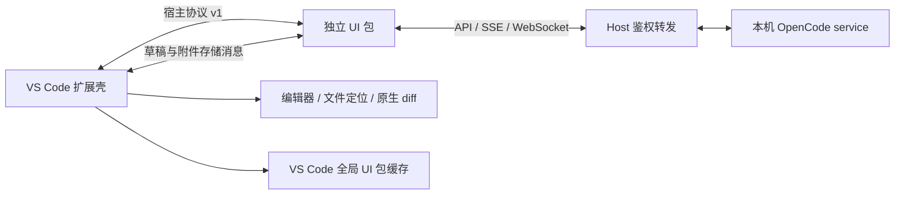
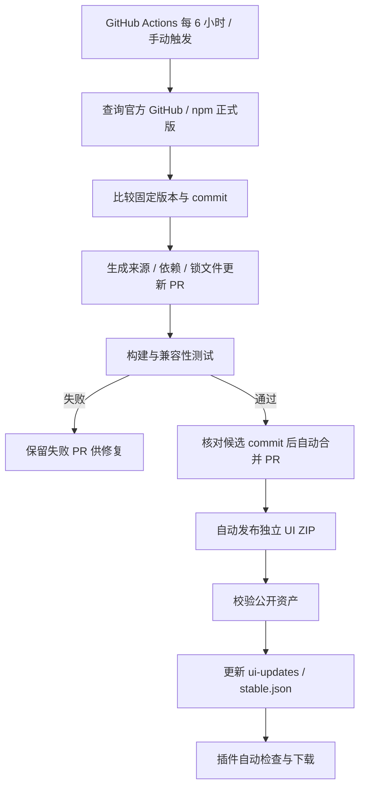

# UI-001 — 独立 UI 适配包设计与实施记录

结论：将官方 UI、Client SDK 和版本适配一起打成独立包；VS Code 扩展仅保留服务发现、宿主消息协议和原生编辑器能力。通过 UI 包更新减少 VSIX 发布频率。

状态：下文是原 0.2.0 设计与验证记录；用户已暂停自动更新方案。全部 Actions 已停用、托管附件已清空，改为源码分发与本地构建，见 SOURCE-ONLY.md。所有代码与构建产物位于 E:/opencode-vscode；E:/opencode 继续作为只读来源。

## 目标与边界

| 层 | 保留内容 | 更新条件 |
|---|---|---|
| 扩展壳 | 本机 service 发现／启动、私有鉴权、HTTP/SSE/WebSocket 转发、编辑器捕获、文件定位、原生 diff、工作区存储、UI 包管理 | VS Code 原生能力、service 命令或宿主消息协议需要变化 |
| UI 包 | 官方 Solid UI、Client SDK、Composer／路由／主题适配、Worker／SVG 适配、与 service 交互 | 官方 UI／API／事件结构变化或 UI 适配修复 |
| 更新清单 | UI 包版本、固定来源、宿主协议版本、服务兼容范围、下载地址、SHA256 | 发布新 UI 包后更新 |

UI 与服务版本不同不代表必然不兼容。自动更新只选择清单中声明兼容的 UI 包；没有匹配包时提示当前版本尚未验证，延续既有 service 复用策略。任何更新过程均尊重 service disabled，并不按 UI 版本更换用户运行中的 service。

第一版先拆分当前已验证的 OpenCode 2.1.2 UI。服务兼容范围只在完成相应测试后扩展，不预先宣称后续所有版本可用。

## 宿主协议

在现有 src/protocol.ts 的消息契约上声明版本 1，UI 包握手校验协议版本。普通新增可选字段保持兼容；必须改变语义时才提升协议版本。

保留当前文件与精确选区快照、未保存内容、文件定位、主题、路由、草稿和附件 Blob 操作。

原生 diff 改为：UI 使用配套 SDK 获取 session diff → 发送已定义的文件与 patch 结构 → Host 验证消息并显示原生 diff。移除 Host 的 OpenCode SDK 运行时依赖，避免 UI 升级后 Host 仍受 SDK 约束。

草稿、附件与 tab 继续使用现有工作区存储键；UI 包版本不进入这些键，避免普通更新创建一套空状态。

## 包与清单

首个独立 UI 包命名：

- GitHub Release 标签：ui-2.1.2-vscode.1。
- 附件：opencode-ui-2.1.2-vscode.1.zip。
- 包内包含 index.html、静态资源、ui-manifest.json、来源记录与第三方许可。

采用独立的 ui-updates 分支存放 stable.json，下载地址固定为该分支的 GitHub raw 地址。UI Release 设置 make_latest=false，保持 GitHub 的 latest Release 指向 VSIX 发布。

| 清单字段 | 含义 |
|---|---|
| schemaVersion | 更新清单格式版本 |
| id | UI 包唯一版本，例如 opencode-2.1.2-vscode.1 |
| upstreamVersion / upstreamCommit | 官方固定源码版本与 commit |
| hostProtocol | 兼容的宿主消息协议 |
| serviceRange | 经验证的 service 兼容范围 |
| url / sha256 / size | 固定 Release 资产地址、完整包校验和大小 |
| entry | 包内 Webview 入口 |

同一个 UI 包版本发布后保持内容不变；适配修改产生新修订。ZIP 在临时目录下载、校验 SHA256、检查解压路径和清单，再安装到按包版本划分的缓存目录。

## 客户端更新策略

已确认的首版策略：正常更新无需手动确认、合并 PR、下载 UI 或重新安装 VSIX。首次升级扩展壳至 0.2.0 后，自动检查、下载和使用兼容 UI 包。

| 场景 | 行为 |
|---|---|
| 首次安装 | VSIX 内附当前已验证 UI，基本使用无需等待网络下载 |
| 自动检查 | 打开侧栏时检查；6 小时内重复打开复用检查结果；可关闭自动更新 |
| 发现兼容新包 | 后台下载、校验并缓存，显示重载后可用 |
| 正在聊天或编辑草稿 | 当前 Webview 继续使用原包，普通自动更新不打断会话 |
| 生效 | 下次启动 VS Code 或重建 Webview 自动使用已下载的新包；应用命令用于主动提前切换 |
| 应用 UI 更新 | 等待当前草稿和 Blob 写入完成，工作中则提示稍后应用 |
| 更新失败 | 当前 UI 继续使用，日志记录失败；没有完成验证的包不标记为可用 |
| 新包无法完成启动握手 | 回退至上一个成功加载的兼容包，内置包作为最后备用 |
| 手动回退 | 提供回退命令并固定该选择，避免下一次自动检查立即切回问题包 |

UI 包缓存放在 ExtensionContext.globalStorageUri 下，多个窗口可复用下载；每个已打开 Webview 使用固定版本，不因其他窗口更新而被替换。

新增命令：OpenCode: Check UI Updates、OpenCode: Apply UI Update、OpenCode: Roll Back UI。设置提供自动更新开关。

## 上游监测与发布

同时跟踪官方 GitHub 正式 Release 与 @opencode/cli npm latest，排除 draft 和 prerelease，不跟踪 dev 的每次提交。GitHub Actions 在同一仓库准备更新 PR；它是候选更新的变更记录与异常处理入口，正常通过后无需用户手动合并。不需要在插件中配置 GitHub token。

流水线使用固定 commit 的官方源码与对应版本的独立测试 service。自动准备候选更新不能保证上游变化无需人工适配；失败停止发布，修复后重跑。

用户已确认发布策略：候选更新的必需构建与兼容性测试全部通过后，自动合并 PR、自动发布 UI 包、自动更新 stable.json；正常流程没有人工确认步骤。校验和发布必须对应同一个候选 commit，不能使用旧提交的通过结果。ZIP 上传并校验后才更新清单，避免向客户端提供不存在的资产。

Actions 内置 GITHUB_TOKEN 创建 PR 或推送 commit 不会自动触发一般的 push／pull_request workflow。流水线必须显式串联候选验证与发布（workflow_dispatch、可复用 workflow 或同一运行中的后续 job），不能依赖机器人推送自然触发 CI。初始化仓库所需配置随本次实现完成，正常更新不要求用户维护 token 或反复操作设置。

构建、兼容性测试、自动合并或发布失败时，停止推进更新清单，保留最后已验证版本；失败记录和候选 PR 用于排查。需要调整宿主协议或扩展原生能力时，才发布新 VSIX。

## 文件修改清单

保留现有文件结构，按三个阶段推进；不重写官方业务逻辑。

| 文件 | 改动 |
|---|---|
| src/ui/manifest.ts、src/ui/packages.ts、src/ui/archive.ts（新增） | 清单校验／兼容选择、缓存与更新切换、ZIP 安装 |
| src/protocol.ts | 明确宿主协议 v1、UI 握手和原生 diff 数据契约 |
| src/sidebar.ts、src/extension.ts | 选择 UI 目录、更新／应用／回退命令、加载回退 |
| src/editor.ts、src/storage.ts | 原生 diff 改为接收 UI 的结果，清除 Host 对 OpenCode SDK 的运行时／类型依赖 |
| webview/entry.tsx、webview/bridge.ts、webview/editor.tsx、webview/review.ts（新增） | 协议握手、包信息、SDK diff 查询与更新时的状态保存 |
| scripts/build.ts、scripts/build-host.ts、scripts/build-ui.ts（后两者新增） | 分离扩展壳与 UI 构建；保留现有一键构建入口 |
| ui-package.json、scripts/ui-package.ts（新增） | UI 包声明与可复现的 ZIP／清单构建 |
| scripts/setup.ts、scripts/ui-upstream.ts（后者新增） | 为官方新版本准备来源、依赖和锁文件候选更新 |
| scripts/ui-publish.ts（新增） | 发布 UI 资产、校验下载、更新 stable.json |
| .github/workflows/ci.yml、ui-upstream.yml、ui-release.yml（后两者新增） | 分离产物、定时发现、候选验证与发布 |
| package.json、bun.lock、tsconfig.json、tsconfig.webview.json、.vscodeignore | 新命令／设置、加载器依赖、构建边界、插件版本 0.2.0 |
| test/ui-packages.test.ts（新增） | 包选择、下载完整性、安装切换、失败回退及手动回退状态 |
| scripts/ui-update-smoke.ts（新增），现有附件／VS Code smoke | 模拟发布源实际更新并发送，验证草稿、GBK、原生 diff 和重载 |
| README.md、CHANGELOG.md、docs/UI-PACKAGES.md、docs/VALIDATION.md、docs/WORKLOG.md | 更新与发布说明、设计、验证和工作记录 |

如实现中发现需要增加影响范围，先说明具体原因。首版无需迁移或删除现有会话、草稿和附件。

## 实施顺序与验收

1. 拆分构建与 SDK 边界：相同官方 UI 独立打包，扩展只依赖宿主协议，先确保现有功能跑通。
2. 增加下载／校验／缓存／切换／回退：用本地发布源验证完整更新流程，保护当前窗口和工作区状态。
3. 配置监测与发布：核对 GitHub CI、发布首个独立 UI 包并初始化清单，交付 0.2.0 VSIX 供用户安装自测。

必要验证：bun run check、包管理器关键契约测试、UI ZIP 构建、VSIX 构建，以及真实 VS Code 中的 GBK 文件／未保存选区发送、重载草稿恢复、文件定位、原生 diff、UI 更新和回退。

不改变用户现有 service 的版本或运行状态。最终完成标准仍为用户在日常项目中亲自验收。

## 实现与验证结果

- Host 构建检查拒绝任何 .upstream 或 @opencode 运行时输入；SDK 和 GUI 适配只在 UI 包内。
- 清单与 ZIP 分离构建，包路径、大小、SHA256、manifest 和协议在安装前校验，成功后进入不可变版本目录。
- 13 项单测通过；真实浏览器完成 UI 下载／切换／回退，草稿恢复，GBK 发送和 SDK diff 请求。
- 真实 VS Code 1.94 完成 GBK 和未保存选区发送、文件定位、原生 diff、更新与回退后再次发送。
- UI validation 为可复用 workflow，验证同一 source commit 的 Windows/Linux 产物；自动监测通过 needs 串联验证、合并和发布，不依赖机器人 push 触发 CI。
- 对应版本的测试 CLI 从官方 npm 平台包获取，并校验发布包的 SHA512 integrity；测试 XDG 与端口隔离。
- 当 GitHub Release 与 npm 版本不同，以更高的正式版准备更新；必须存在官方不可变 tag，且源码 package.json 版本一致。
- 普通自动检查间隔 6 小时；已有缓存可离线加载。下载失败和启动失败保留旧包；手动回退固定选择。
- UI 缓存位于 globalStorageUri/ui，草稿与 Blob 继续使用既有工作区存储，不按 UI 版本另起命名空间。

## 公开交付

- [v0.2.0 VSIX](https://github.com/HunkYuan/opencode-vscode/releases/tag/v0.2.0) 已公开，32.04 MB；安装并正常重载一次后使用独立 UI 更新。
- [stable.json](https://raw.githubusercontent.com/HunkYuan/opencode-vscode/ui-updates/stable.json) 当前覆盖 OpenCode 2.1.2 与 2.1.4，各自使用精确验证版本声明。
- [首次自动更新](https://github.com/HunkYuan/opencode-vscode/actions/runs/40060291615) 已从 npm 发现 2.1.4，验证 Windows/Linux 后自动合并 PR #1、发布并校验 UI ZIP，最后更新清单。
- [最终 UI 验证](https://github.com/HunkYuan/opencode-vscode/actions/runs/40061233451) 与 [扩展 CI](https://github.com/HunkYuan/opencode-vscode/actions/runs/40061206849) 成功；[2.1.2 兼容包验证与发布](https://github.com/HunkYuan/opencode-vscode/actions/runs/40062127251) 成功。
- UI Release 使用独立 ui-* 标签，latest Release 为 v0.2.0 VSIX。失败的候选不会推进 stable.json。
- 安装包：33,600,292 bytes，2827 ZIP entries，SHA256 8e4e69306370fccb4aaa18ce6ee2d0c87643e7325a2536294940a11f2d418855；从公开下载地址重新校验一致。
